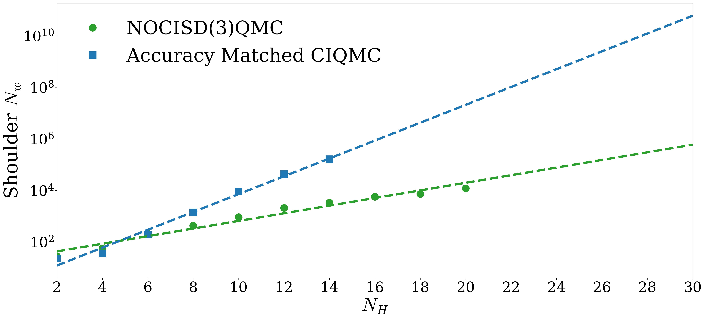
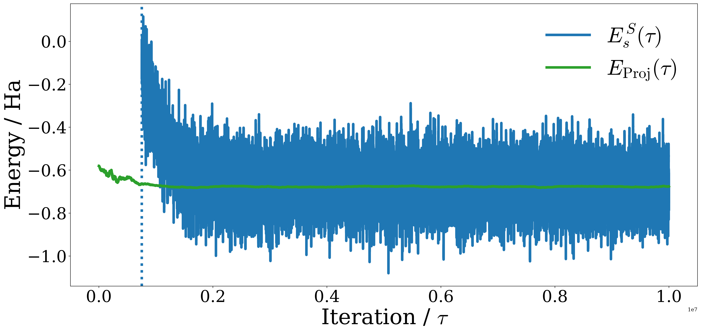
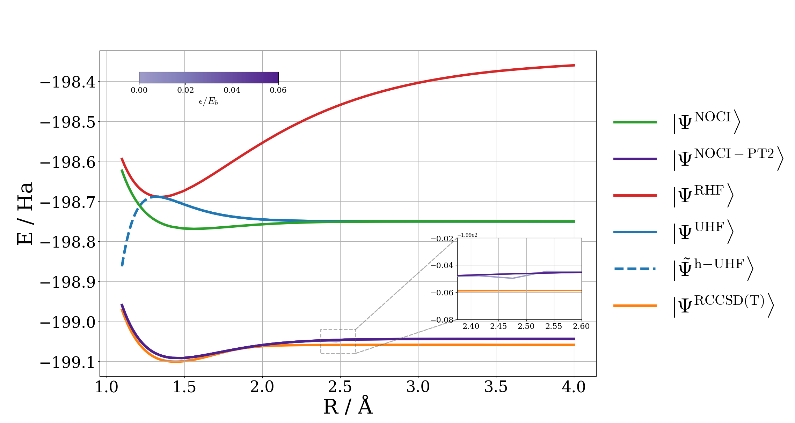

  

  <em>Nonorthogonal electronic structure in Rust.</em>

  
  
  
  

  

<h3 align="center">
  <a href="https://noci-rs.readthedocs.io/en/latest/getting-started/installation.html">Install</a>
  &nbsp;·&nbsp;
  <a href="https://noci-rs.readthedocs.io/en/latest/getting-started/quickstart.html">Quick start</a>
  &nbsp;·&nbsp;
  <a href="https://noci-rs.readthedocs.io/en/latest/methods/index.html">Methods</a>
  &nbsp;·&nbsp;
  <a href="https://noci-rs.readthedocs.io/en/latest/input/index.html">Input reference</a>
  &nbsp;·&nbsp;
  <a href="https://noci-rs.readthedocs.io/en/latest/citing.html">Citing</a>
</h3>

---

  

Shoulder population $N_w$ against hydrogen chain length $N_H$ for NOCISD(3)QMC and accuracy matched CIQMC in the STO-3G basis. The measured shoulders are extrapolated, demonstrating the large compression of NOCIQMC relative to CIQMC at comparable accuracy.

  

Typical evolution of the projected energy $E_{\mathrm{Proj}}(\tau)$ and shift $E_s^S(\tau)$ for the H20 linear chain at 1.5 Å in the STO-3G basis using the `b-apply` propagator. The same trajectories can also be seen for `s-apply`.

  

NOCI-PT2(3) calculation for F2 in the cc-pVDZ basis. The NOCI-PT2 method recovers much of the dynamical correlation absent from reference NOCI, shown by good agreement with the CCSD(T) energies. Use of the non-orthogonal Wick's theorem for matrix elements allows larger first-order spaces to be treated than was previously possible.

---

  Research software under active development · <a href="LICENSE">MIT licence</a> · <a href="CONTRIBUTING.md">Contributing</a>

