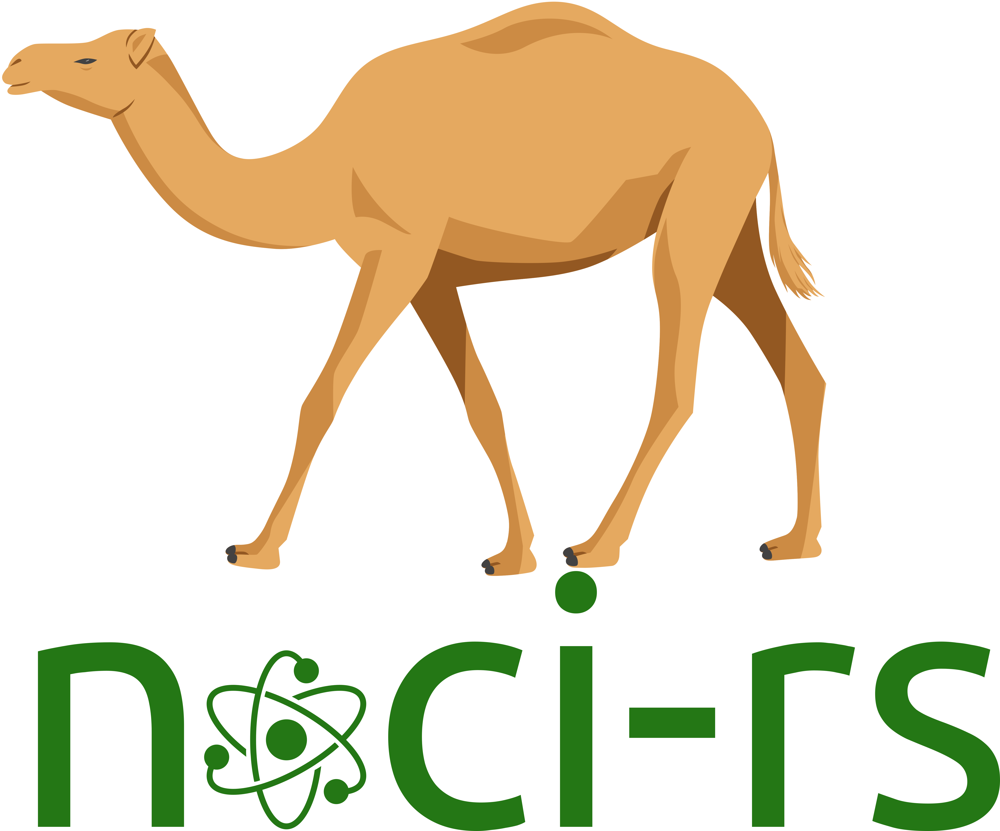

  

  <em>Nonorthogonal electronic structure in Rust.</em>

  
  
  
  

  

<h3 align="center">
  <a href="https://noci-rs.readthedocs.io/en/latest/getting-started/installation.html">Install</a>
  &nbsp;·&nbsp;
  <a href="https://noci-rs.readthedocs.io/en/latest/getting-started/quickstart.html">Quick start</a>
  &nbsp;·&nbsp;
  <a href="https://noci-rs.readthedocs.io/en/latest/methods/index.html">Methods</a>
  &nbsp;·&nbsp;
  <a href="https://noci-rs.readthedocs.io/en/latest/input/index.html">Input reference</a>
  &nbsp;·&nbsp;
  <a href="https://noci-rs.readthedocs.io/en/latest/results.html">Results</a>
  &nbsp;·&nbsp;
  <a href="https://noci-rs.readthedocs.io/en/latest/citing.html">Citing</a>
</h3>

---

  Research software under active development · <a href="LICENSE">MIT licence</a> · <a href="CONTRIBUTING.md">Contributing</a>

